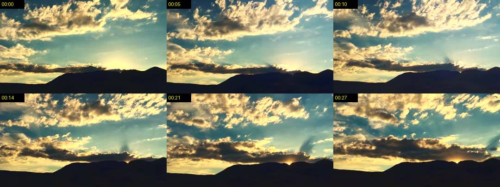

# Claude-Look

**Let Claude watch videos.** Paste a TikTok, Instagram Reel or X link into Claude Code and ask
what it's about. Claude-Look grabs the key frames and a transcript, Claude looks at them, and
everything is deleted afterwards.

[Leer en español](README.es.md)

```
You:    https://www.tiktok.com/@someone/video/123 what is this about? is it worth copying?
Claude: (runs Claude-Look, reads 1 contact sheet + transcript)
        It's a 28 s reel where... At 00:13 the screen shows...
```


*One contact sheet: only the frames where the scene changes, each with its timestamp. Example video: [Time Lapse Clouds above Steens Mountain](https://commons.wikimedia.org/wiki/File:Time_Lapse_Clouds_above_Steens_Mountain_(36203941112).webm) (public domain, Wikimedia Commons).*

## Why

- **Sees and hears.** Key frames (on-screen text, products, scenes) plus a timestamped transcript.
- **Cheap on tokens.** Instead of dozens of frames, Claude reads 1-2 small sheets of up to 6
  frames each. Static parts of the video are skipped automatically.
- **Private.** Transcription runs locally with Whisper. Nothing is sent to any extra service.
- **Leaves nothing behind.** Video and audio are deleted as soon as the frames are extracted; the
  sheets are deleted when Claude finishes.
- **No accounts, no keys.** No cookies, no logins, no API keys. Public content only.

## Install

**Requirement:** [uv](https://docs.astral.sh/uv/getting-started/installation/). It installs
Python, ffmpeg and the rest automatically on first run, in an isolated environment.

```bash
# macOS / Linux
curl -LsSf https://astral.sh/uv/install.sh | sh
```

```powershell
# Windows
powershell -ExecutionPolicy ByPass -c "irm https://astral.sh/uv/install.ps1 | iex"
```

### Option A: as a plugin (recommended)

Inside Claude Code:

```
/plugin marketplace add JuanchoNV/Claude-Look
/plugin install claude-look@claude-look
```

### Option B: as a personal skill

```bash
git clone https://github.com/JuanchoNV/Claude-Look.git
cp -r Claude-Look/skills/claude-look ~/.claude/skills/
```

On Windows (PowerShell):

```powershell
git clone https://github.com/JuanchoNV/Claude-Look.git
Copy-Item -Recurse Claude-Look\skills\claude-look "$env:USERPROFILE\.claude\skills\"
```

Personal skills work in every project. To share it with a team, copy the folder into the
project's `.claude/skills/` instead.

## Use

Just paste a link and ask:

- "What is this video about? `<link>`"
- "What product appears at the end of `<link>`?"
- "Summarize the hooks used in these 3 reels: `<link>` `<link>` `<link>`"

The first run takes 1-2 minutes while dependencies download. After that, a short video takes
about 10-20 seconds.

You can also run the script yourself:

```bash
uv run skills/claude-look/look.py "<url>" [--max-frames 12] [--model base] [--lang en] [--no-audio]
uv run skills/claude-look/look.py clean
```

| Option | Default | What it does |
| --- | --- | --- |
| `--max-frames` | 12 | Max key frames kept (6 per sheet) |
| `--model` | base | Whisper model: `tiny`, `base`, `small` (more accurate, slower) |
| `--lang` | auto | Audio language: `en`, `es`, `pt`... |
| `--no-audio` | off | Skip transcription |

## How it works

1. **Download** the lightest version (max 480p) into a temp folder with
   [yt-dlp](https://github.com/yt-dlp/yt-dlp).
2. **Frames:** one tiny frame per second; only frames that differ from the previous kept one
   survive, plus the last frame (usually the call to action).
3. **Sheets:** frames are packed into 3x2 JPG sheets with timestamps.
4. **Transcript:** audio is transcribed on your machine with
   [faster-whisper](https://github.com/SYSTRAN/faster-whisper).
5. **Clean up:** video and audio are deleted immediately; the sheets go when Claude runs `clean`.

What stays on disk: the uv package cache and the Whisper model (~150 MB), so they aren't
downloaded every time.

## Supported sites

| Site | Status |
| --- | --- |
| TikTok | Works without login |
| Instagram Reels (public) | Works without login |
| X / Twitter, Facebook, Vimeo and [many more](https://github.com/yt-dlp/yt-dlp/blob/master/supportedsites.md) | Usually work |
| YouTube | Often blocked without login ("confirm you're not a bot") |

Private content and anything behind a login is not supported, by design.

## Responsible use

Use it to understand content you're allowed to view. Respect each platform's terms and
creators' rights: don't use it to re-upload or redistribute other people's videos.

## Credits

Built on [yt-dlp](https://github.com/yt-dlp/yt-dlp),
[faster-whisper](https://github.com/SYSTRAN/faster-whisper),
[imageio-ffmpeg](https://github.com/imageio/imageio-ffmpeg) and
[Pillow](https://python-pillow.org/).

## License

[MIT](LICENSE)
